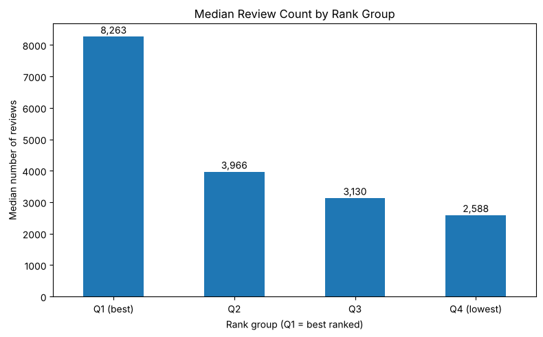
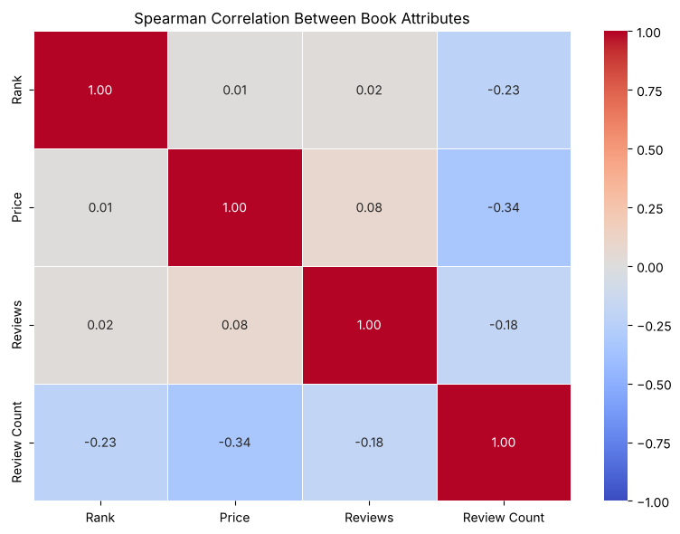
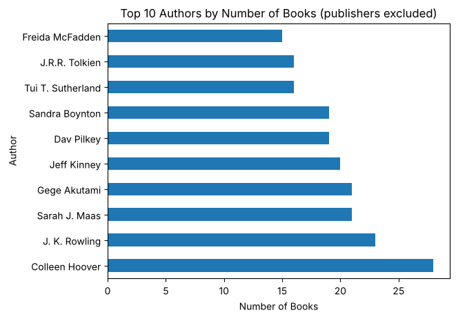
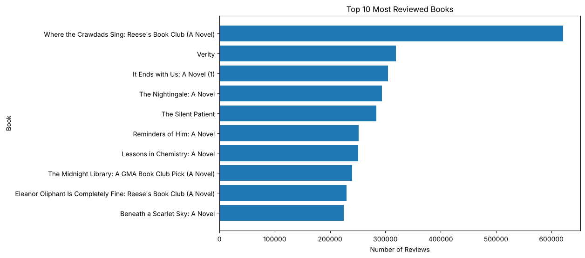

# Amazon Bestseller Book Analysis

Exploratory data analysis (EDA) of 4,846 Amazon bestseller listings: ratings, review counts, prices, authors,
genres, and what is associated with a better sales rank.

**Tools:** Python, pandas, NumPy, Matplotlib, Seaborn, Jupyter

> **Data source:** _add the link and credit for where `amazon_books.csv` was downloaded._
> The file has no collection date; many titles are 2024 calendars, so it looks like a snapshot from around
> 2023 to 2024. Prices are assumed to be in USD and `Rank` is assumed to be the best-seller rank (1 = best).

## Key findings

* **Review count is the only attribute linked to rank.** The best-ranked quarter of listings has about 3.2x the
  median review count of the lowest-ranked quarter (8,263 vs 2,588), while rating and price barely differ.
  Spearman correlation of Rank with review count is -0.23; with price and rating it is about 0.
* **Cheaper listings tend to have more reviews** (Spearman -0.34). Pearson shows only -0.14 because review counts
  are extremely skewed, which is why this project uses Spearman for its main correlations.
* **Ratings are tightly bunched** (mean 4.66, median 4.7), so a star rating alone says little about a bestseller.
* **Authors:** Colleen Hoover has the most listings (28), followed by J. K. Rowling (23) and Sarah J. Maas (21).
  Maas's titles sit much closer to the top (median rank 133). The list is diverse: 75% of authors appear once and
  the top 10 account for only 4.2% of listings.
* **Genres:** Fantasy is the most common (160 listings). By median price, Bibles are the most expensive genre
  (\$18.97) and Bears, Dogs and Dinosaurs the cheapest (about \$5 to \$6).

<p align="center">
  
  
</p>
<p align="center">
  
  
</p>

## Data cleaning

The raw file looks clean (no identical duplicate rows) but has hidden problems, handled in section 4 of the notebook:

| Problem | Fix |
|---|---|
| The same author spelled several ways (`Goggins David` / `David Goggins`) | Order-insensitive name key, mapped to the most common spelling |
| The same book listed as several editions with shared reviews | Kept the best-ranked edition: 4,846 to 4,701 rows (145 removed) |
| "Authors" that are really publishers (`Calendars Workman`) | Excluded from the author ranking with a hand-curated list |
| Calendars, box sets and puzzle books mixed in with books | Tagged in a `Type` column (kept in the analysis) |
| Missing `Brand` (35%) and `Number of Pages` | `Brand` filled with `Unknown`; pages left empty, not imputed |

## Project structure

```
.
├── analysis.ipynb          # full analysis
├── data/
│   └── amazon_books.csv    # raw data
├── images/                 # charts used in this README
├── requirements.txt
└── README.md
```

## How to run

```bash
pip install -r requirements.txt
jupyter notebook analysis.ipynb
```

## Limitations

* Single undated snapshot; there are no sales figures, only rank, ratings and review counts.
* Correlations show association, not causation (reviews and sales influence each other).
* Author clean-up and duplicate removal use heuristics, so a few mistakes remain.
* About 13% of listings are non-books (calendars, box sets, puzzle books); they are tagged but not removed.
